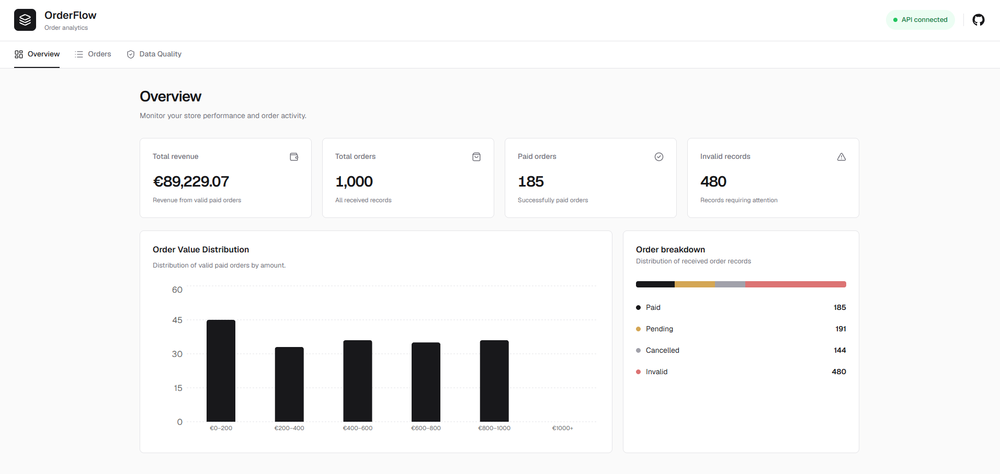
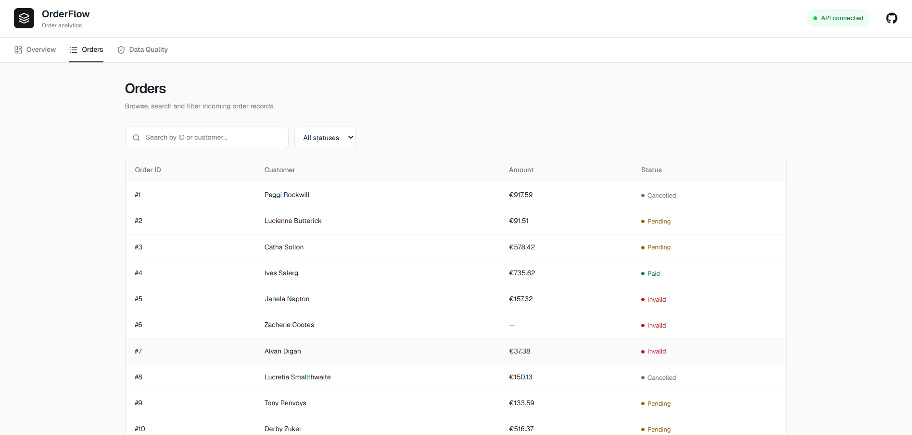
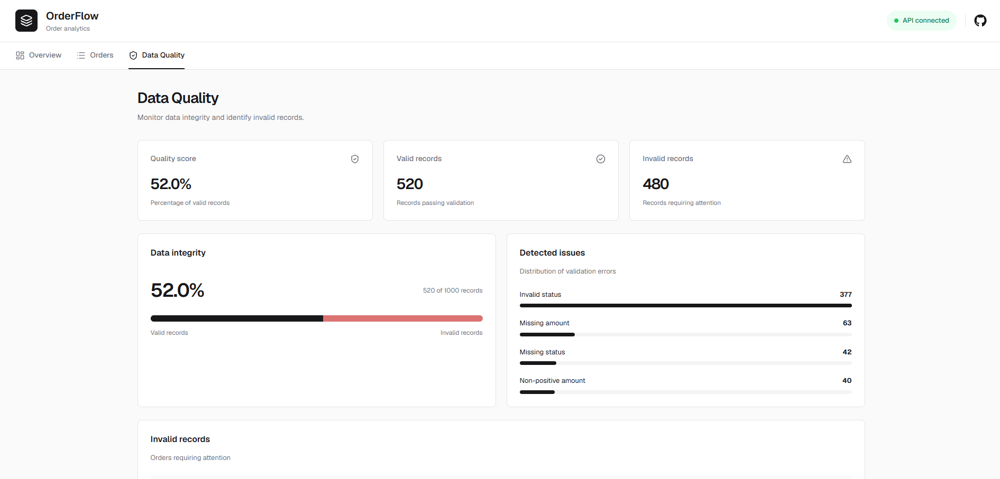

# OrderFlow

OrderFlow is a web-based dashboard for processing,
analyzing, and validating order data.

The project started with a small JavaScript function
that calculates the total amount and number of valid
paid orders. I decided to extend this idea into a
complete React application to explore how business
logic can be integrated into a practical user interface.

## Live Demo

https://order-flow-chi-tan.vercel.app

## Features

### Overview
- Total revenue from valid paid orders.
- Total number of orders.
- Paid and invalid order statistics.
- Order status breakdown.
- Distribution of paid orders by amount.

### Orders
- Browse 1,000 simulated order records.
- Search by order ID or customer name.
- Filter orders by status.
- Pagination with 20 records per page.

### Data Quality
- Validate incoming order records.
- Calculate the percentage of valid records.
- Identify missing or invalid values.
- Display validation errors for each invalid record.
- Analyze the frequency of different data issues.

### API Integration
- Fetch order data through a REST API.
- Display loading and connection states.
- Handle unsuccessful API requests.
- Use JSON Server for local development.
- Use a serverless API in production.

## Technologies Used

| Technology | Purpose |
|------------|---------|
| React | User interface |
| JavaScript | Business logic |
| Vite | Development and build tooling |
| CSS | Styling and layout |
| Recharts | Data visualization |
| JSON Server | Local REST API |
| Node.js | Serverless API |
| Vitest | Unit testing |
| ESLint | Code quality |
| Vercel | Deployment |
| Git & GitHub | Version control |

## Project Structure

```text
orderFlow/
├── api/
│   └── orders.js
├── public/
├── src/
│   ├── components/
│   ├── services/
│   │   └── orderService.js
│   ├── utils/
│   │   ├── orderFunction.js
│   │   ├── dataValidation.js
│   │   ├── orderProcessing.js
│   │   └── *.test.js
│   ├── App.jsx
│   └── main.jsx
├── db.json
├── package.json
├── vite.config.js
└── vercel.json
```

## How It Works

1. The application fetches order records from the API.
2. Each record is checked against validation rules.
3. Valid and invalid records are classified separately.
4. The original order processing function calculates
   the revenue and number of valid paid orders.
5. The processed results are passed to React components
   for visualization and analysis.

The application keeps data fetching, business logic,
validation, and UI components separate.

## Data Validation

The validation logic checks for:

- Invalid order objects.
- Missing order IDs.
- Missing amounts.
- Invalid amount types.
- Zero or negative amounts.
- Missing order statuses.
- Unsupported order statuses.

Supported order statuses are:

- paid
- pending
- cancelled

Records that fail validation are classified as invalid
and displayed with their corresponding errors.

The dataset contains simulated records, including
intentionally invalid values, to demonstrate how
the application handles imperfect data.

## Getting Started

### Prerequisites

- Node.js (compatible with the project's Vite version)
- npm
- Git

### Installation

Clone the repository:

```bash
git clone https://github.com/MutassemAlsaifi/order-flow.git
cd order-flow
npm install
```

Start the local API:

```bash
npm run server
```

In a separate terminal, start the React application:

```bash
npm run dev
```

The application is available at:

http://localhost:5173

The local API is available at:

http://localhost:3000/orders

## Testing

The business logic is tested using Vitest to ensure that
order processing, data validation, and analytics work
correctly under different scenarios.

The tests are independent of the React interface and
do not require a running API.

### Testing Approach

The tests follow the Arrange, Act, Assert (AAA) pattern:

- **Arrange:** Prepare the input data.
- **Act:** Execute the function being tested.
- **Assert:** Compare the actual result with the expected result.

### Vitest Functions

The following functions and matchers are used:

| Function | Purpose |
|----------|---------|
| `describe()` | Groups related test cases. |
| `it()` | Defines an individual test case. |
| `expect()` | Creates an assertion for the actual result. |
| `toBe()` | Checks exact equality. |
| `toEqual()` | Compares the contents of objects and arrays. |
| `toContain()` | Checks whether an array contains a specific value. |
| `toContainEqual()` | Checks whether an array contains an equivalent object. |
| `toHaveLength()` | Verifies the number of elements. |
| `toBeCloseTo()` | Compares decimal numbers with a tolerance. |

### Test Example

```js
it('calculates paid orders correctly', () => {

    // Arrange
    const orders = [
        { amount: 100, status: 'paid' },
        { amount: 50, status: 'paid' },
        { amount: 200, status: 'pending' }
    ]

    // Act
    const result = handelOrder(orders)

    // Assert
    expect(result).toEqual({
        sum: 150,
        count: 2
    })
})
```

This test verifies that only valid paid orders are
included in the total revenue and order count.

For decimal calculations, `toBeCloseTo()` is used
instead of exact equality because JavaScript
floating-point arithmetic may introduce small
rounding differences.

### Test Coverage

| Test File | Tested Functionality | Results |
|-----------|----------------------|---------|
| `orderFunction.test.js` | Revenue, paid order count, invalid amounts, null records, and decimals | 5/5 |
| `dataValidation.test.js` | Valid records, invalid amounts, unknown statuses, and multiple errors | 5/5 |
| `orderProcessing.test.js` | Dashboard statistics, invalid records, issue counts, and amount distribution | 5/5 |
| **Total** | **Business logic** | **15/15 passed** |

These tests cover selected business logic scenarios.
UI testing and live API testing are not included.

### Running the Tests

Run all tests once:

```bash
npm run test:run
```

Run tests in watch mode during development:

```bash
npm run test
```

### Test Results

```text
✓ dataValidation.test.js   (5 tests)
✓ orderFunction.test.js    (5 tests)
✓ orderProcessing.test.js  (5 tests)

Test Files  3 passed (3)
Tests       15 passed (15)
```
## Code Quality

Run ESLint:

```bash
npm run lint
```

Create a production build:

```bash
npm run build
```

## Deployment

The application is deployed on Vercel.

In production, order data is served through a read-only
serverless API that reads the local JSON dataset.

API endpoint:

https://order-flow-chi-tan.vercel.app/api/orders

This project uses simulated data and is intended
for demonstration and educational purposes.

## Screenshots

### Overview



### Orders



### Data Quality




## Author

Mutassem Alsaifi

GitHub: https://github.com/MutassemAlsaifi